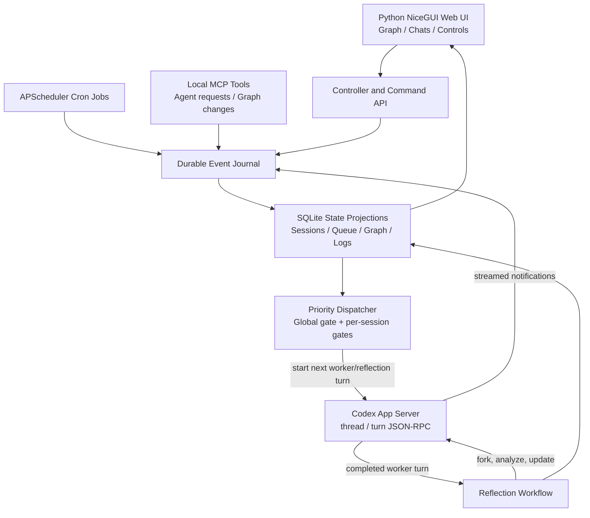

# Agent Controller — Final Architecture and Implementation Specification

**Version:** 1.0 (design baseline, 27 October 2026)  
**Status:** Ready for implementation  
**Primary language:** Python  
**Agent harness:** Locally installed Codex CLI, operated through `codex app-server`  
**Deployment:** Single computer; local browser UI; SQLite persistence

## 1. Product objective

Build a local, event-driven Python application that creates, operates, observes, and coordinates persistent Codex sessions. A session is the fundamental unit of agent work. Sessions may execute user prompts, agent-to-agent requests, or cron-triggered autonomous work. After every successfully completed worker turn, a dedicated Codex reflection fork analyzes the outcome, revises metadata where appropriate, publishes a structured summary to directly adjacent sessions, and evaluates whether its context should be divided into new sessions.

The user must be able to see the session graph, click a node to inspect a full harness-style conversation, send prompts, configure cron schedules, manage graph relationships, interrupt individual turns, pause all new prompts, and stop all active turns. No work is to be launched merely because a neighboring session changed its title or summary.

## 2. Confirmed decisions (authoritative)

| # | Decision | Requirement |
|---|---|---|
| 1 | Controller-owned only | Only sessions created or forked by this controller are managed. Do not import existing independent terminal/IDE sessions. |
| 2 | Full browser control | Full conversation viewer, live tool logs, prompts, approvals when applicable, interruption, resume, forks, schedules, graph editing. |
| 3 | Autonomous graph changes | Agents can create/fork sessions, rename, split, define parent-child/sibling relationships, and reorganize the graph without user approval. |
| 4 | Restricted agent contact | An agent may send actionable requests to directly adjacent graph neighbors or to its parent and grandparent (at most two manager levels upward). |
| 5 | Shared working directory | Sessions on the same project use the same filesystem working directory; no Git worktrees. |
| 6 | Fully autonomous cron | A scheduled session may select and execute useful work, including code, tests, deployment, and external operations allowed by its Codex permissions. |
| 7 | LLM-selected split structure | During splitting the LLM chooses whether the original becomes coordinator, is archived, or continues as one specialized branch; and chooses parent-child or sibling relationships. |
| 8 | Queue, don't interrupt automatically | At most one active worker turn per session. New inputs queue; user > agent requests > cron priority. |
| 9 | Complete conversation history | Retain prompts, replies, tools, outputs, timestamps, diffs, approvals, and events. Display temporary reflection forks as expandable sections in the worker turn. |
| 10 | No controller-imposed resource quotas | Do not add artificial token budgets, session-count caps, agent chain-depth limits, or concurrency quotas. Maintain observability and correctness invariants. |
| 11 | Local-first deployment | Single Python service, local Codex process, SQLite DB, local browser UI. Do not build distributed workers for v1. |
| 12 | Global pause/stop controls | A global pause blocks **all new Codex prompts**, including worker, reflection, split-handoff, cron and agent-request activations. An optional Stop All interrupts all active turns. |
| 13 | Per-turn Stop | Each active prompt has a visible Stop button that interrupts that specific Codex turn and holds that session from automatic redispatch until resumed. |

### Important distinction: fully autonomous does not mean unstoppable

The user's explicit global and per-session stop controls override agent-generated scheduling or graph changes. This is control-plane correctness, not a resource or autonomy quota.

## 3. Technology selections

- **Codex transport:** one Python-managed `codex app-server` subprocess over local stdio JSON-RPC. Python owns thread creation, resumption, forking, turn dispatch, interruption, notifications, and approval responses.
- **Python backend:** Python 3.12+ with `asyncio`, `pydantic`, `aiosqlite`, and `APScheduler` (or equivalent durable cron scheduling). One main application process runs the scheduler, dispatcher, UI, and Codex event reader.
- **Browser interface:** NiceGUI (Python-defined UI), using Apache ECharts through `ui.echart` for the interactive relationship graph. NiceGUI provides live server-driven updates and chat-style controls without requiring hand-written frontend JavaScript.
- **Persistence:** SQLite in WAL mode, indexed relational projections and append-only event journal. Store large immutable tool-output payloads as compressed local blobs where sensible, with SQLite pointers; do not truncate history.
- **Agent communication:** a local MCP tool service hosted by Python, accessible from controller-owned Codex threads. Its authorization rules are enforced at the controller boundary.
- **Git:** used only for project inspection and change tracking, not isolation or forced branching.

The implementation must generate the installed Codex version's protocol JSON Schema with `codex app-server generate-json-schema --out ./schemas` and use those definitions to validate integration messages. Pin and test a supported Codex CLI version; do not assume sample response shapes are stable indefinitely.

Documentation: [Codex App Server](https://learn.chatgpt.com/docs/app-server), [NiceGUI ECharts](https://nicegui.io/documentation/echart).

## 4. High-level architecture



**Data-plane vs. control-plane:** Codex performs the work and reasoning. Python owns event durability, scheduling, session graph, queue admission, stop state, communications routing, validation, and UI. The graph and controller state do not depend on mutable Codex session titles.

## 5. Core identities and session states

Every managed session has a stable `session_id` (controller UUID) and `codex_thread_id` (Codex identifier), mutable title, objective, scope contract, working directory, model/settings, current context usage, parent linkage (if any), cron schedule (optional), and summary revision.

### Session status

`ready`, `running`, `waiting_for_approval`, `waiting_for_dependency`, `reflecting`, `splitting`, `held`, `failed`, `completed`, `archived`.

### Turn status

`queued`, `claimed`, `starting`, `running`, `interrupt_requested`, `completed`, `interrupted`, `failed`, `abandoned`.

A session has at most one running worker turn. A reflection fork has a distinct internal role (`reflection`) and is never shown as an ordinary graph node by default. Controller-issued maintenance/compaction operations also have explicit internal roles.

## 6. Event model and activation semantics

### The only worker-activation sources

1. `work.manual_submitted`: a user prompt from the browser interface or local controller CLI.
2. `work.agent_requested`: an authorized query, work request, or awaited reply from another controller-owned session.
3. `work.cron_due`: a configured schedule triggers an autonomous review and bounded work turn.

Each becomes a durable `work_item`, with a target session, priority, creation timestamp, correlation/request ID, original payload, and status.

### Passive events (NEVER dispatch a worker turn)

- `session.title_changed`
- `session.summary_published`
- `session.relationship_changed`
- `session.created` (registration alone)
- `neighbor.context_updated`

These change metadata or a passive context inbox only. Context delivery happens when some independent activation actually starts a future worker turn.

### Lifecycle/internal events

- `codex.turn_started`, `codex.item_started`, `codex.item_delta`, `codex.item_completed`
- `codex.turn_completed` (completed/failed/interrupted)
- `reflection.queued`, `reflection.completed`, `reflection.failed`
- `split.proposed`, `split.committed`, `context.compacted`
- `controller.paused`, `controller.resumed`, `turn.stop_requested`, `turn.interrupted`
- `cron.due`, `cron.skipped_while_paused`, `approval.requested`, `approval.resolved`

All events contain `event_id`, UTC timestamp, type, origin, entity IDs, correlation ID, optional causation ID, and JSON payload. Ingest with unique keys for idempotency. The event journal is append-only; state projections are derived from it.

## 7. Dispatcher, queues, and scheduling

- Per-session FIFO within priority class: (1) user prompts, (2) agent requests and awaited replies, (3) cron activations.
- Never interrupt a running turn for a newer request. The user may explicitly Stop the active turn.
- Only one running worker turn per session. Different sessions may execute concurrently; no controller-wide concurrency quota.
- A queued work item remains durable until dispatched, cancelled, or explicitly superseded.
- Duplicate cron firings for the same schedule period are coalesced. While globally paused, cron fires are recorded as skipped and not replayed by default. Manual and authorized agent requests continue to be queued during a pause.
- A cron does one explicit Codex turn per scheduled activation. That turn can autonomously decide what to do, or return `no_work`; there is no unconditional Python loop that repeatedly prompts an idle session.
- User prompts submitted while dispatch is globally paused are saved and clearly marked `Queued (controller paused)`.

### Prompt composition

On dispatch of a work item, assemble:

1. Durable session objective and scope (with explicit non-goals).
2. Exactly one actionable input (manual / agent request / cron objective review).
3. Current titles and summaries of **all directly adjacent** active graph neighbors.
4. Consolidated changes since last acknowledged delivery, including decision IDs and relevant open dependencies.
5. Correlation metadata for any agent request/reply.

Read neighbor context **just before dispatch**, not when the work item was initially queued. Store a delivery snapshot/revision mapping per turn. Only mark the snapshot delivered once `turn/start` has been acknowledged; on uncertain starts, reconcile before retrying. Neighbor context is informational, not a directive to violate scope.

## 8. Global Pause, Stop All, per-turn Stop (non-negotiable)

### A. Global `Pause New Prompts`

- Global persisted controller state `dispatch_mode = paused | running`, with revision/generation and `changed_at` metadata.
- When `paused`, the controller must not issue any new `turn/start` (or other controller-initiated model invocation), from **any** source: manual, agent request, cron, reflection, split handoff, or maintenance prompts. Previously executing turns may finish and may continue their internal model/tool activity; use **Stop All Running** to interrupt them.
- No agent can remove the pause, including an agent that creates new sessions or modifies cron schedules.
- The dispatcher and pause handler use one serialized dispatch gate. A pause response is acknowledged only after all dispatches already in the `turn/start` critical section have resolved. Thereafter no new `turn/start` is issued until resume.
- Pause must survive service restart. No automatic resume on boot.
- Pause is not equivalent to shutdown or cancelling currently running work.

### B. `Stop All Running`

1. Persist global pause and close the dispatch gate.
2. Enumerate all active worker, reflection, and other controller-owned model turns.
3. Issue `turn/interrupt` for each active turn, preserving their identities.
4. Show `Stopping` until Codex reports completion with `interrupted`, or an explicit error/unknown state.
5. Reconcile and log any remaining background processes (turn interruption may not terminate independently spawned processes).

### C. Per-turn `Stop`

- Show a red Stop button whenever a turn is active, including reflections in the expanded inspector.
- Button triggers an idempotent `turn/interrupt` with the exact Codex `threadId` and `turnId`. Example RPC: `{"method":"turn/interrupt","id":42,"params":{"threadId":"thr_123","turnId":"turn_456"}}`.
- Immediately set the controller session's `hold_after_stop` flag and UI state `Stopping` so an interrupted session cannot automatically dispatch the next queued item.
- Confirm terminal status from `turn/completed(status="interrupted")` (or failure/timeout recovery), preserve partial output and tool events, and display `Interrupted by user`.
- Do **not** produce a normal successful-turn reflection or distribute a success summary after an interrupted turn. Keep the partial transcript visible.
- The user may explicitly `Resume Session`, which clears the hold and enables the pending queue. Do not silently rerun the interrupted prompt; a manual `Retry` action may enqueue it as a new turn.
- Stopping one session must not stop unrelated sessions.

**Caveat:** Interrupting a turn is not transactional rollback. Changes already written to disk, detached subprocesses, and external side effects may persist. Display a warning when applicable and provide logs/status to inspect them. The UI must never claim an interruption has fully completed until Codex confirms it.

### D. UI control visibility

- Always-visible global header: `Pause New Prompts` / `Resume Dispatch`, `Stop All Running`, count of running turns, queue length, global status.
- Every selected active session: `Stop Turn`, `Hold Session` / `Resume Session`, execution status and time elapsed.
- Queued requests can be cancelled independently. Approvals are shown when the Codex permissions profile requires human response.

## 9. Agent-to-agent communication and graph authorization

Graph edges have a **type**, with independently stored conversation lineage:

- `PARENT_OF` (directed, acyclic managerial hierarchy)
- `SIBLING_OF` (undirected peer relationship)
- `DEPENDS_ON` (directed work dependency)
- `RELATED_TO` (undirected direct adjacency)
- `FORKED_FROM` (directed historical lineage; does **not** automatically imply ongoing communication)

### Active contact rules

A requesting session may send a query/work request to:

1. Any direct neighbor connected by an active *communication-enabled* edge, irrespective of its direction.
2. Its immediate parent (`manager depth 1`).
3. Its grandparent (`manager depth 2`).

It may not directly contact arbitrary distant sessions. Fork-lineage-only or archived nodes are not automatically contactable. Manager hierarchy must have at most one active direct parent per node and cannot contain cycles. Graph lookup may show all session titles and statuses but actionable MCP methods validate the target relationship server-side.

### Agent requests are asynchronous

- Agent calls a controller MCP tool such as `agent_send_query(target, question, expects_reply)`.
- Python validates authorization, creates a durable request, and immediately returns `request_id` / queued receipt; do not block a Codex tool call waiting for another session's entire turn.
- The target gets a high-priority work item. Response carries the original correlation ID. A waiting requester receives the reply as actionable input; otherwise a response can be stored as an explicitly attributable inbox item until a valid activation.
- Replayed tool calls must not create duplicate requests; retain request/response acknowledgements and causal records.

### Passive neighbor propagation

After a reflection updates a session title or summary, write versioned metadata and notify **direct communication neighbors only** by updating their passive context views. Do not enqueue a work item. At the next real activation, include each neighbor's latest title, current summary, and consolidated undelivered changes. Never forward summaries transitively without a separate, explicit agent request.

### MCP tools

`agent_list`, `agent_get_status`, `agent_get_graph`, `agent_send_request`, `agent_send_query`, `agent_reply`, `agent_create_session`, `agent_fork_session`, `agent_update_scope`, `agent_set_relationship`, `agent_remove_relationship`, `agent_set_cron`, `agent_get_request_status`.

All tools submit validated commands to the controller; agents do not write controller SQLite tables directly. Fully autonomous agent-generated graph changes require no user approval but must satisfy referential integrity and parent-hierarchy rules.

**Security limitation:** with unrestricted local shell and shared OS credentials, these API restrictions are cooperative application policy, not a hard isolation boundary against a malicious local process. True adversarial enforcement would require separate OS identities/sandboxing, which is outside v1.

## 10. Post-turn reflection workflow

After a successful worker `turn/completed`:

1. Persist final Codex turn and item details.
2. If dispatch is paused, queue reflection but **do not start** it.
3. Otherwise create an ephemeral, read-only Codex `thread/fork` anchored to the completed `turnId`; set role `reflection`, never schedule it as a worker.
4. Provide the prior title, current objective/scope, last completed turn, graph metadata, and a strict structured-output schema.
5. Ask Codex whether the title should change, what was accomplished, what was decided, what was resolved, what remains, blockers/dependencies, evidence paths, and a concise summary for neighbors.
6. Ask for context splitting evaluation when current context occupancy exceeds the configured threshold.
7. Validate JSON using Pydantic, verify important claimed results against stored tool/file evidence where practical, write title/summary revisions, and update the graph/inboxes.
8. Mark the reflection complete; display it expandable under the completed worker turn.

A reflection fork never triggers another reflection. Failed reflection jobs remain visible/retryable and must not mark the original worker turn failed.

### Structured reflection output (conceptual)

```json
{
  "rename": {"required": false, "new_title": null},
  "summary": "Implemented and tested invoice retrieval.",
  "accomplishments": ["Added GET /api/invoices"],
  "decisions": [{"id":"decision-17","text":"Use paginated responses"}],
  "resolved": ["Invoice endpoint not found"],
  "remaining_work": ["Add retry behavior"],
  "blockers": [],
  "artifacts": ["src/invoices.py"],
  "split": {"recommended": false, "reason": null, "relationship": null, "branches": []}
}
```

Reflection reports are facts/proposals, not authority to fabricate test outcomes. The controller validates fields and enforces invariants.

## 11. Context splitting and lifecycle

- Trigger split evaluation when measured **current context occupancy**, not cumulative billed tokens, exceeds **200,000 tokens**. Use App Server `thread/tokenUsage/updated`. If the selected model's actual context window is less than this threshold, proactively evaluate earlier to avoid context-window failure; record why.
- Ask the reflection fork whether it can identify **at least two independent actionable topics** with clear objectives and boundaries. If not, remain as-is and consider compaction.
- If splitting is justified, ask the LLM to choose the original session's future role and either parent-child or sibling structure. The controller atomically records a split plan, creates/forks appropriate sessions, assigns scope contracts (`in_scope`, `out_of_scope`, deliverables, dependencies), and updates relationships.
- Use `thread/fork` for true lineage where preserving history is appropriate. **Forking alone does not reduce context.** For effective isolation, compact branches or create fresh scoped successors from the fork-produced handoff package while recording the original Codex fork provenance. Do not claim that two full forks have halved context size.
- New work sessions receive their first actionable assignment through the normal work queue. Global pause prevents these controller-initiated first prompts from starting until resumed.
- No hard cap on split count or concurrency is imposed by Python. Validate structural correctness and idempotence to avoid accidental duplicates from retries.
- Historical sessions remain inspectable even when archived. An original session that becomes a manager is assigned a coordination scope; if it becomes a specialized worker, its scope is updated accordingly.

## 12. Cron autonomous execution

Each session may optionally have a cron expression, timezone (default system timezone, configurable), enable flag, last scheduled time, last due time, last started time, last finished time, next due time, and recent outcomes.

The cron input asks Codex to review its own objective, latest decisions, tasks remaining, blockers and direct-neighbor updates; select a useful in-scope action; execute the action with its configured permissions; verify its result; or respond with `no_work`. Sessions may create additional sessions, communicate, and change their own schedules/relationships if doing so is relevant.

When globally paused, scheduled firings must be recorded as skipped (not executed and not silently replayed). When an individual session is held, cron activations should be recorded and coalesced until it is resumed; manual work must not be lost.

## 13. Shared workspace rules

All sessions associated with a project point to the same `cwd`. There is no worktree branching by the controller, and cross-session work can proceed concurrently. Each worker turn records observed modified paths, Git status/diff snapshots where possible, and command activity. The UI should highlight overlapping edits and stale assumptions. Cooperative file ownership/lease hints may be exposed as advisory graph metadata, but the controller must not silently impose a global worker concurrency cap.

Acknowledge the remaining inherent risk: two agents can overwrite the same file or operate on inconsistent state in a shared directory. Show conflicts and their provenance; do not pretend shared-directory mode guarantees conflict-free edits.

## 14. Browser UI specification

Implement a responsive, Python-defined NiceGUI interface with a live ECharts force-directed graph and a full session inspector.

### Global header

- Controller running/paused state, **Pause New Prompts** / **Resume Dispatch** toggle, **Stop All Running** button.
- Counts of running worker turns, reflections, held sessions, pending actionable requests, unread updates, and failures.
- Local time and recent error/connection status.

### Graph panel (primary navigation)

- Nodes represent controller-owned work sessions; title, status, truncated scope, optionally context pressure and next cron time.
- Different edge treatments/colors for `PARENT_OF`, `SIBLING_OF`, `DEPENDS_ON`, `RELATED_TO`, and lineage (lineage can be toggled off).
- Clicking a node opens that session's inspector; clicking an edge shows its type, history, and permissions. No work starts from selection.
- Search/filter by title, status, project, work relationship; pan/zoom; current and historical graph view; add/modify/reparent/remove relationships.
- Do not show internal reflection forks as graph nodes in normal view; show them embedded beneath original turns.

### Session inspector

1. **Chat** (default): full chronological prompts and agent responses with badges for manual, agent request/reply, and cron; streaming response; timestamps; expandable tool calls and command output; file diffs; errors and approvals; expandable reflection result and original reflection transcript per completed turn.
2. **Overview**: session title, immutable ID, Codex thread ID, objective, scope, graph neighbors, manager chain, current status, current context/token metrics, last triggered, last started, last completed, last error.
3. **Schedule**: cron editor and timezone, enabled/disabled, last due, last run finished, next due, missed/skipped runs and `no_work` outcomes.
4. **Activity**: chronological event timeline (title changes, summaries, graph restructuring, forks, cron events, stop/resume, requests).
5. **Requests / Inbox**: actionable queue, outgoing questions, waiting dependencies, pending passive context and delivered revisions.
6. **Logs**: detailed runtime view with command outputs, trace/correlation IDs, Codex notifications, token usage, and export to JSONL.
7. **Controls**: submit prompt, stop active turn, hold/resume session, cancel queued work item, manage graph, archive session, retry failed/previous interrupted work as an explicit new turn.

### Full Codex harness controls

The UI must display Codex approval requests when its configured permissions demand them and allow user approval/decline; full autonomy is allowed if the selected Codex approval policy grants it. Avoid using the separate unsandboxed `thread/shellCommand` interface for routine agent work.

### History and event sources

Use `thread/turns/list` and `thread/items/list` for paginated stored Codex history. Use live `item/*` and `turn/*` notifications for streaming. Preserve the controller's own event journal for schedule, communication, and graph history. Join by stable thread/turn/item identifiers, not message text.

## 15. SQLite logical model

Core tables (exact columns/indexes decided during implementation):

| Table | Responsibility |
|---|---|
| `controller_state` | Global dispatch pause mode/revision, startup and connection state. |
| `sessions` | Controller/Codex IDs, mutable title, scope, status, settings, project, cwd, context metrics, per-session hold. |
| `session_edges` | Typed graph edges, active state, communication-enabled flag, creator, revision. |
| `work_items` | Durable actionable queue with source, priority, correlation, status, retry/outcome, timing. |
| `turns` | Identity, source work item, Codex turn ID, state, timing, token usage, final outcome. |
| `turn_items` | Codex item identity, type, JSON metadata, output blob reference, timing, status. |
| `reflections` | Worker turn -> reflection fork, JSON analysis, title/summary decision, lifecycle. |
| `summaries` | Versioned summary, title revision, decisions, artifacts, prior revisions. |
| `context_delivery` | Per target turn: neighbor summary versions included and acknowledged. |
| `agent_requests` | Request/reply IDs, source/target, authorization, response, dependency state. |
| `cron_schedules` | Expression, timezone, enabled state, next/last due, skip and result history. |
| `approvals` | Pending Codex approval request and recorded decision. |
| `events` | Append-only UUID event journal with correlation, causation, data, UTC times. |
| `artifacts` | Optional compressed immutable event/output blobs and references. |

Use SQLite transactions for all queue claims and graph mutations. Set WAL, busy timeout, appropriate indexes, migrations, and backup/export. Keep model/user secrets out of raw dashboard data where possible while retaining inspectable execution metadata.

## 16. Local API and MCP surfaces

Illustrative local routes; paths are controller-defined rather than Codex APIs:

```text
GET  /api/controller/status
POST /api/controller/pause
POST /api/controller/resume
POST /api/controller/stop-all
GET  /api/sessions
POST /api/sessions
GET  /api/sessions/{id}
POST /api/sessions/{id}/prompts
POST /api/sessions/{id}/hold
POST /api/sessions/{id}/resume
POST /api/turns/{id}/stop
POST /api/turns/{id}/retry
GET  /api/sessions/{id}/turns
GET  /api/sessions/{id}/events
GET  /api/graph
POST /api/graph/relationships
GET  /api/cron
PUT  /api/cron/{schedule_id}
```

The UI may call Python services directly rather than exposing every route. Any API that changes execution must check paused/held state in the same dispatch-control model as the scheduler.

## 17. Codex App Server integration (documented APIs)

- Initialize with `initialize` and `initialized` once for the local app-server connection.
- Session creation/resume: `thread/start`, `thread/resume`; fork: `thread/fork` with `lastTurnId` and optionally `ephemeral: true` for reflection.
- Prompt execution: `turn/start` with `threadId` and composed input; never use `turn/steer` for queued user requests, because the user chose noninterruption and serialized turn inputs.
- Completion: `turn/completed`, inspect `completed`, `interrupted`, `failed` distinctly.
- Per-turn stop: `turn/interrupt` with exact `threadId` and `turnId`.
- Context and history: `thread/tokenUsage/updated`, `thread/turns/list`, `thread/items/list`.
- Title: `thread/name/set` in addition to the controller's own title history.
- Context maintenance: `thread/compact/start` when selected by the split/compaction workflow.
- Approvals: respond to Codex's server-initiated JSON-RPC approval requests according to configured policy.

This design uses App Server notifications as its authoritative event source. CLI hooks and remote Agents API webhooks are **not required** for controller-owned local sessions. Do not register global hooks that accidentally capture unmanaged IDE/terminal threads. Do not enable independent Codex Goal auto-continuation or external schedulers that could start turns without consulting the Python dispatch gate. If native Codex subagents/tool activity remain possible inside a running turn, distinguish them from *controller-issued new turns*; a global Pause does not freeze internal work already underway.

## 18. Failure recovery and correctness

- On restart, load the global pause and per-session hold flags **before** resuming dispatch. If state cannot be verified, fail closed to `paused`.
- Restart/reconnect `codex app-server`, resume known controller-owned threads and reconcile in-flight turn status. Do not start a duplicate turn when the original start succeeded but its acknowledgement was lost.
- Use stable `work_item_id` and dispatch identity to deduplicate retries/events; queue claims and notification ingestion are idempotent.
- Recover pending reflection jobs from completed worker turns exactly once, but only when dispatch is permitted.
- Rebuild graph and queue projections from the event journal when needed; preserve historical title revisions.
- On stop request, report pending/interrupted/failed cancellation states accurately. Never assert that a detached process was killed without checking.
- Track overlapping writes in the shared project directory; preserve provenance and surface conflicts.
- Run UI on loopback by default and require local authentication if exposed beyond loopback. Keep API and MCP secrets separate from agents' prompt-visible content wherever practical.

## 19. Suggested repository structure

```text
agent-controller/
  pyproject.toml
  README.md
  config.yaml
  AGENT_CONTROLLER_SPEC.md
  app/
    main.py
    settings.py
    api.py
    orchestrator.py
    dispatcher.py
    event_bus.py
    scheduler.py
    session_manager.py
    codex_rpc.py
    codex_events.py
    reflection.py
    split_manager.py
    prompt_builder.py
    graph_service.py
    message_router.py
    mcp_server.py
    db.py
    models.py
    migrations/
    ui/
      app.py
      graph.py
      session_chat.py
      inspector.py
      controls.py
  prompts/
    worker_base.md
    autonomous_review.md
    reflection.md
    split_planner.md
    split_handoff.md
  schemas/
    codex-app-server/
    reflection.schema.json
  tests/
    unit/
    integration/
    ui/
    fixtures/
  data/                     # ignored by Git
    controller.sqlite
    event_blobs/
```

## 20. Implementation sequence

**Phase 1 — Durable core / stop semantics:** create the SQLite schema, event journal, global dispatch gate, per-session queue, process supervisor, and Codex RPC adapter. Implement `Pause New Prompts`, `Resume`, `Stop Turn`, and `Stop All` before enabling autonomy. Prove no new `turn/start` after pause acknowledgement.

**Phase 2 — Session runner and UI:** create controller-owned threads, send/resume prompts, store complete Codex events, build NiceGUI session list, interactive graph and selected-session chat, stream outputs, show timestamps and working stop controls.

**Phase 3 — Reflection + neighbor context:** ephemeral read-only fork after completed worker turns, structured reflection output, title/summary versioning, direct-neighbor propagation, next-turn prompt assembly and delivery receipts.

**Phase 4 — Agent graph and communication:** MCP tools, active contact authorization, graph edits including autonomous creation/forking, async query/reply, manager chain, graph event timeline.

**Phase 5 — Cron autonomy, splitting, hardening:** durable cron scheduler, autonomous review turns, token/context pressure measurement, split planning and scoped branch creation, recovery/reconciliation tests, full logging/export.

Phases represent development order, not artificial runtime resource caps.

## 21. Acceptance tests (must pass)

1. **Global pause:** With 5 sessions and queued user/agent/cron/reflection work, click Pause; after UI acknowledges it, no `turn/start` can be issued until Resume. Active turns may complete. On application restart the pause remains active.
2. **Stop a single turn:** Click Stop on running Session A. Only A gets `turn/interrupt`; its partial output remains visible and becomes `interrupted`, the session becomes held, queued work doesn't start until Resume Session. Session B continues uninterrupted.
3. **Stop all:** Click Stop All; dispatch pauses first, every active worker/reflection turn receives interruption, and unresolved/detached processes are reported rather than silently marked stopped.
4. **User queue priority:** With A busy, submit two user prompts, one agent query, and a cron trigger. A completes current turn without interruption, then dispatches user prompts before agent query, then cron unless coalesced.
5. **Neighbor context:** A publishes new title/summary. Direct neighbors B and C remain idle. B's next manually triggered turn includes A's latest title and summary; nonneighbor D receives no update.
6. **Two-level manager contact:** C may send a query to its parent A and grandparent R, but not to unrelated D. Direct-neighbor contact is allowed regardless of edge direction; lineage-only edges don't grant contact.
7. **Reflection isolation:** Successful worker completion generates exactly one read-only reflection; the reflection never reflects on itself; its raw conversation is expandable under the worker turn, not a normal graph node.
8. **Split behavior:** A session exceeding 200,000 current context tokens is evaluated. When 2+ actionable topics exist, the LLM's role/relationship plan is applied, scoped successor sessions are created, provenance is retained, and successors do not accidentally inherit unbounded context without compaction/handoff.
9. **Cron schedule:** Session detail shows cron expression, timezone, last due, last started, last finished, next due, and skipped runs. Cron can execute autonomous work; while paused, firing is logged but starts no prompt.
10. **Full history:** Graph node click opens paginated real conversation history including prompts, commands, outputs, file changes, approvals, and exact timestamps. Running prompts show live deltas and Stop Turn.
11. **Crash recovery:** Kill controller while A is working, restart while globally paused: known turns reconcile against Codex and are not duplicated; manual requests and graph changes are retained.
12. **Autonomous graph changes:** An agent creates a peer and relationship without asking the user, within graph-integrity rules; the graph updates live and only an explicit work item activates the new session.
13. **Shared directory:** Two session changes in one cwd are observed. A detected overlapping file edit appears as a conflict warning with both turn IDs; no worktree is created.
14. **No quotas:** The controller does not enforce artificial concurrency, token, cost, session-count or request-chain budgets; explicit stop controls remain authoritative.
15. **Unsuccessful turn:** A failed or interrupted worker turn does not publish a misleading success summary, and remains fully inspectable.

## 22. Out of scope for v1

- Managing sessions created outside the controller.
- Distributed or remote worker nodes.
- Git worktree isolation or automatic conflict-free merging.
- Automatic rollback of stopped Codex turns or external side effects.
- Autonomous model-imposed policy changes that override the user's stop/pause state.
- Using HTTP webhooks from the hosted Agents API as a requirement for local Codex sessions.

## 23. Definition of done

The application is complete when a user can start the local Python service, open a browser, create Codex sessions, view and manipulate their relationship graph, click any session to inspect its complete live/historical conversation, send prompts and stop them, pause or stop all new executions, schedule autonomous cron work, allow authorized inter-agent communication, and observe automatic reflection, title/summary updates, and context splits—with all state durable across restarts and with every acceptance test above passing.
